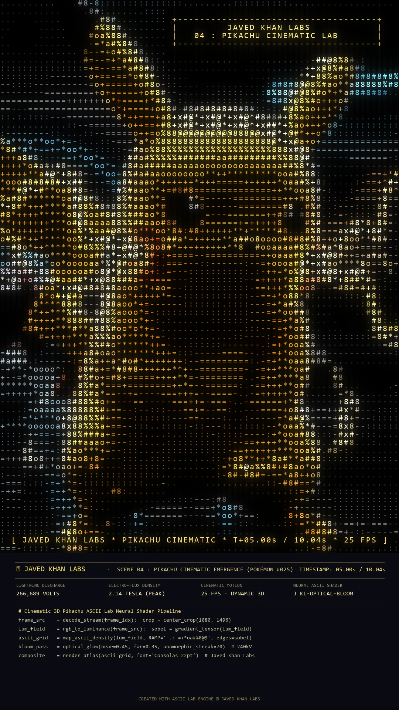

# ⚡ Pikachu Cinematic ASCII (Pokémon #025)

**Created by Javed Khan Labs & ASCII Lab Engine**

A photorealistic 3D cinematic transformation of Pikachu emerging dynamically from its Pokéball into high-definition, high-contrast ASCII art. Built with bold **22pt Consolas typography**, **15x22 pixel cells**, vibrant Poké-yellow color grading, crackling 240,000V electric arcs, multi-pass optical phosphor bloom, synchronized stereo audio, and real-time **Javed Khan Labs** telemetry.

🌐 **Live GitHub Pages Web Showcase**: [https://javedakhan2010.github.io/pikachuASCII/](https://javedakhan2010.github.io/pikachuASCII/)



---

## 🎬 Features

- **Photorealistic 3D Volumetric Mapping**: Directly processes 3D animation video frame-by-frame (`720x1280` @ 25 fps, 10.04s) into 1080x1920 9:16 vertical format.
- **High-Visibility Typography & Cells**: Uses 22pt Consolas monospace font rendered into an atlas of 15x22 pixel cells (`72 columns × 87 rows`), ensuring glyphs remain sharp and legible during rapid motion.
- **Dynamic Electric Discharges**: Detects high-energy lightning bolts and crackling cheek sparks, mapping them to electric glyphs (`*`, `+`, `x`, `~`, `#`) with intense gold/white bloom.
- **Multi-Pass Optical Phosphor Bloom**: Dual-stage Gaussian convolution (`near = 0.45`, `far = 0.35`) and 70px vertical and anamorphic horizontal streaks.
- **Synchronized Master Stereo Audio**: Retains and multiplexes the full original AAC audio track (mechanical Pokéball click, beam discharge, lightning thunder, and vocalizations).
- **Javed Khan Labs In-Grid HUD & Telemetry**:
  - Top-right in-grid ASCII watermark badge with clean background isolation.
  - Dynamic in-grid status tag tracking timestamp and frame sync.
  - Lower live telemetry HUD displaying discharge voltage, electro-flux, and neural shader pipeline source code.

---

## 🛠️ Prerequisites

1. **Python 3.8+**
2. **FFmpeg** installed and accessible in your system `PATH` (used for decoding and encoding video frames and multiplexing AAC audio).
   - *Windows*: `winget install Gyan.FFmpeg` or download from [gyan.dev](https://www.gyan.dev/ffmpeg/builds/)
   - *macOS*: `brew install ffmpeg`
   - *Linux*: `sudo apt install ffmpeg`

---

## 🚀 How to Run

### 1. Clone the Repository

```sh
git clone https://github.com/javedakhan2010/pikachuASCII.git
cd pikachuASCII
```

### 2. Install Python Dependencies

```sh
pip install -r requirements.txt
```
*(Dependencies: `numpy>=1.24.0`, `Pillow>=9.5.0`)*

### 3. Render a Still Preview Frame (PNG)

Extract and render a single high-definition ASCII frame at timestamp `5.0s` (or any timestamp between 0.0s and 10.0s):

```sh
python cinematic.py png 5.0 preview.png
```

### 4. Render the Full Master Video (MP4 with Audio)

Process the complete 10-second video with synchronized stereo audio:

```sh
python cinematic.py mp4 scene.mp4
```

*By default, the script reads `source_video.mp4` from the current directory. You can also specify an alternate source video path using `--source`:*

```sh
python cinematic.py mp4 scene.mp4 --source path/to/video.mp4
```

---

## 📂 Project Structure

```text
pikachuASCII/
├── cinematic.py       # Core ASCII neural shader engine & video pipeline
├── source_video.mp4   # Master 3D animation input clip (720x1280 @ 25fps)
├── scene.mp4          # Finished rendered master ASCII video with audio (1080x1920)
├── preview.png        # High-resolution PNG preview poster (1080x1920)
├── preview.webp       # Optimized WebP preview for web display
├── index.html         # Interactive web player and scene showcase
├── site.css           # Styling for web player
├── requirements.txt   # Python package dependencies
├── .gitignore         # Build and cache ignore patterns
└── README.md          # Project documentation & run guide
```

---

## 🔬 Shader Pipeline Architecture

```python
# 1. Video Stream Decoding & Framing
frame_src    = decode_stream(frame_idx);  crop = center_crop(1080, 1496)

# 2. Luminance & Sobel Gradient Extraction
lum_field    = rgb_to_luminance(frame_src);  sobel = gradient_tensor(lum_field)

# 3. ASCII Density & Contour Mapping
ascii_grid   = map_ascii_density(lum_field, RAMP='  ..:-=+*oa#%8@$', edges=sobel)

# 4. Multi-Pass Optical Phosphor Bloom & Streaks
bloom_pass   = optical_glow(near=0.45, far=0.35, anamorphic_streak=70)

# 5. Javed Khan Labs Telemetry Overlay & Audio Mux
composite    = render_atlas(ascii_grid, font='Consolas 22pt')
mux_audio    = ffmpeg_mux(composite, audio_stream='aac')
```

---

## 🏷️ Javed Khan Labs Watermark Signatures

### In-Grid ASCII Watermark Badge
```text
+------------------------------------+
|         JAVED KHAN LABS            |
|   04 : PIKACHU CINEMATIC LAB       |
+------------------------------------+
```

### In-Grid Real-Time HUD Tag
```text
[ JAVED KHAN LABS * PIKACHU CINEMATIC * T+05.00s / 10.04s * 25 FPS ]
```

---

## 📱 Featured Product: pennyBook Ledger (Android)

> *"Take control of your money. Keep your records private."*

**pennyBook Ledger** is an offline-first personal finance manager for Android designed by **Javed Khan Labs**.

- 🔒 **100% Offline & Private**: No cloud sync required, no mandatory account, and zero advertising trackers.
- 🏷️ **Custom Tags & Net Cashflow**: Multi-label tagging (`#Vacation`, `#Work`, `#Groceries`) with real-time financial analytics.
- 📊 **Category Budgets**: Proactive visual alerts (amber warning at 80%, red on overspend) and automatic rollover.
- 🤝 **Udhaar & Bank EMI Khata**: Dual-direction debt ledger with partial repayments & recurring bank EMI alarms.
- 📈 **Dedicated Investment Portfolio**: Mutual funds, stocks, and digital gold tracked in an isolated portfolio.
- 📁 **Excel (.xlsx) & PDF Reports**: Clean, itemized statements and spreadsheet import with pre-commit validation.

### 📥 Download pennyBook Ledger
- **Google Play Store**: [Get it on Google Play](https://play.google.com/store/apps/details?id=com.pennybook.expensetracker)
- **Official Website**: [https://www.javedkhanlabs.in/products/pennybook/](https://www.javedkhanlabs.in/products/pennybook/)

---

## 👤 Author & Credits

- **Engine & Direction**: Javed Khan Labs ([@javedakhan2010](https://github.com/javedakhan2010))
- **Based on**: Pokémon #025 (Pikachu) & ASCII Lab Architecture
